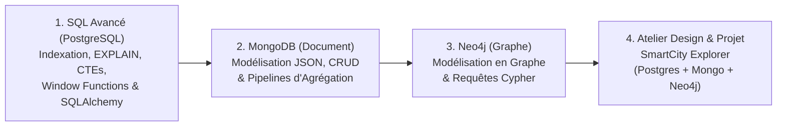

# 🗄️ Persistance Polyglotte : SQL Avancé & NoSQL — ESIGELEC Poitiers

Bienvenue sur l'espace GitHub du module **Bases de Données SQL Avancé & NoSQL** de l'**ESIGELEC Poitiers**.

---

## 📚 Dépôts de Référence du Cours

| Dépôt | Rôle | Accès |
| :--- | :--- | :--- |
| **[`databases-esigelec/sql-noql`](https://github.com/databases-esigelec/sql-noql)** | **Hub du Cours & TDs** : Support de cours Slidev (SQL Avancé + NoSQL), [Guide de l'Étudiant](https://github.com/databases-esigelec/sql-noql/blob/main/GUIDE-ETUDIANT.md), [Aide-Mémoire](https://github.com/databases-esigelec/sql-noql/blob/main/AIDE-MEMOIRE.md), Ateliers de Design d'Architecture et TDs (`PostgreSQL`, `MongoDB`, `Neo4j`). | Public |
| **`databases-esigelec/smartcity`** | **Projet Fil Rouge — SmartCity Explorer (Édition SQL & NoSQL)** : Application FastAPI + Streamlit combinant **PostgreSQL** (données structurées Villes/Scores), **MongoDB** (Avis textuels & Agrégation) et **Neo4j** (Graphe de similarité & Recommandations) en 4 Sprints. | Template Privé (Équipes) |

---

## 🗺️ Parcours Pédagogique

---

## 🛠️ Stack Technique du Module

- **Bases de données** : PostgreSQL 16 (SQLAlchemy Async / asyncpg) · MongoDB 7 (Motor / PyMongo) · Neo4j 5 (Cypher)
- **Backend & Frontend** : Python 3.11+ · FastAPI · Pydantic · Streamlit · Jupyter Lab
- **Outillage & DevOps** : Docker Compose · `uv` · `just` · Pytest · GitHub Actions (Évaluation continue par Sprint)

---
*Intervenant : **Brice Fotzo** — Tech Lead Data & MongoDB User Group Leader Paris*
